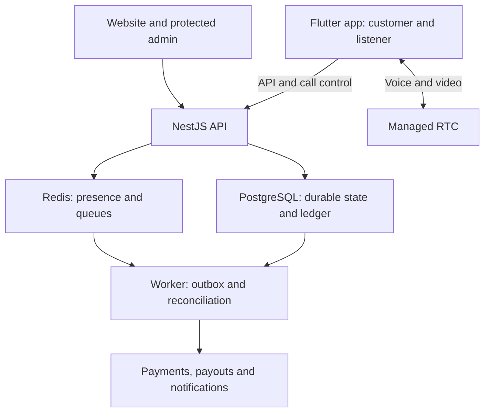

# NightShift — Build Plan and Technical Blueprint

Prepared for Agilan Deenadhayalan · 28 October 2026 · Version 2.0 · revised 20 November 2026

## November 2026 launch requirements

Use ₹500 per 3,600 paid connected seconds as a proposed listener rate. Freeze the rate when the call starts. Count only verified intervals with both participants connected, exclude ringing, waiting and reconnect gaps, deduplicate events and round to paise once per settlement. Show the basis of pay before a listener goes online. A six-minute paid call earns ₹50. Customer pricing remains a launch decision.

The owner's 20 November 2026 decision (D17) selects Firebase paid Phone Authentication SMS to India (+91), superseding the earlier Twilio/MSG91 route. Flutter obtains native phone-verification proof after consented app admission. NestJS verifies the Firebase ID token, phone-provider claims and revocation, then binds the opaque Firebase UID and canonical phone to one app account. Keep server credentials private. FCM remains the selected notification service; delivery evidence is separate. Retain MSG91 only as an optional compatibility adapter with its own sender/template prerequisites. Record manual versus automatic verification and actual sender/brand presentation on real Indian SIMs; provider selection and fixture tests do not establish branded delivery. App admission limits and budget alerts are not a Firebase SMS billing cutoff. See [Firebase setup and evidence](docs/Firebase_Development_Setup.md).

Track SMS cost per successful sign-in, paid seconds per online hour, repeat paid calls and contribution after listener pay, channel fees, RTC, OTP and refunds. Record the price, spend cap and decision owner before taking real payments.

## 1. The recommendation

Build **one independent product inspired by the use cases in FRND and Dostt**, with one Flutter mobile application containing **Customer** and **Listener** modes. Start with Android, Tamil and English, verified adult listeners, direct discovery, an opt-in “Find a listener” flow, and one-to-one audio. Build a public website and a separate protected admin interface. Use **one modular NestJS backend**, PostgreSQL for durable data and money records, Redis for short-lived availability, and Agora for real-time media.

The first valuable milestone is two real Android phones completing a call with correct availability, billing and call history. A good-looking list of profiles alone does not establish that the product works.

This is a planning deliverable. No application has been deployed, no provider has been purchased, and no GitHub repository or issues have been created. The pack includes **64 issue specifications**, implementation prompts and a resumable GitHub importer. Use a new personal-business repository; keep this project separate from Wiley and other employer repositories, credentials and cloud accounts.

**Product name:** NightShift. **Repository:** `nightshift`.

## 2. What the research establishes

Your 53,987-character transcript is the main requirements source. It describes OTP onboarding, nicknames and avatars, language filters, availability sorting, voice/video calls, coins, coupons, history, favorites, listener applications, earnings, invoices, support and account deletion. It also mentions group rooms, personality questions and an AI companion. These are observations and feature requests, not a verified specification of either competitor.

| Topic               | Evidence and limitation                                                                                                                                                                                              | Decision for this product                                                                                                                 |
| ------------------- | -------------------------------------------------------------------------------------------------------------------------------------------------------------------------------------------------------------------- | ----------------------------------------------------------------------------------------------------------------------------------------- |
| FRND                | Its public website describes language-based social interaction, audio/video, games and rooms. Its payment policy distinguishes purchased coins and cash-redeemable Yellow Roses, with conversion affected by badges. | Use separate customer credits and listener earnings; do not assume a universal exchange rate.                                             |
| Dostt               | Its official Play listing describes audio/video connections and identifies Behtar Technology Private Limited. The main website and privacy page returned no readable body in this research environment.              | Treat your detailed in-app walkthrough as user-reported evidence; verify prices and payout rules from screenshots before relying on them. |
| Actual technology   | The retrieved public pages do not establish either company's complete backend, database, infrastructure or current RTC vendor.                                                                                       | The stack below is our recommendation, not a claim about their private systems.                                                           |
| Actual economics    | No verified per-call commission or same-session customer-spend/host-payout pair was obtained.                                                                                                                        | Do not invent a platform cut or company profit from the ₹17 example.                                                                      |
| Price transcription | Some pack values in the transcript are non-monotonic or possibly missing digits. FRND website descriptions also do not fully resolve the paid flow you observed.                                                     | Do not import those lists as a production price catalogue. Capture dated screenshots and channel/offer context.                           |
| Scale               | FRND's website reports 3 million monthly users and 1 million daily conversations as of August 2026; these are company claims, not simultaneous call counts.                                                          | Size infrastructure by peak connected devices, concurrent calls and call minutes.                                                         |

Sources: [S1–S4](docs/Sources_and_Research.md). No private app session was accessed and no competitor payment was made for this research.

## 3. The first release and what follows

**Paid audio MVP:** adult onboarding; language and avatar; manually approved listeners; availability; direct calling; basic opt-in matching; audio; transparent rates; top-ups through the approved store/payment route; server-controlled billing; call history; favorites; reports and blocking; listener earnings and controlled payouts; support; account deletion; administrator tools; public policy pages; monitoring and backups.

**After the audio release is stable:** video with additional privacy and moderation work, consent-based text chat, tightly controlled coupons/referrals, iOS, other languages, richer analytics and eventually a clearly labelled optional AI companion. Video is a first expansion milestone, not silently removed from your idea.

**Defer:** group rooms, games, gifts, subscriptions, personality matching, public social feeds, location matching, automated voice identity recognition, facial recognition, and complex recommendation ML. None is necessary to validate one-to-one paid conversation. Recording a voice sample for manual review does not prove identity, age or gender.

Adult listeners of any permitted gender can apply. Customer and listener permissions depend on verified role and consent, not an assumption that every man pays and every woman earns. Market the service as paid conversation with verified listeners; do not imply romantic interest, professional therapy, guaranteed earnings or guaranteed friendship.

## 4. Applications and technologies

| Part                             | Recommendation                                                                                                            | Why it exists                                                                                                                                               |
| -------------------------------- | ------------------------------------------------------------------------------------------------------------------------- | ----------------------------------------------------------------------------------------------------------------------------------------------------------- |
| Android / later iOS              | Flutter + Dart, Riverpod, GoRouter, generated API client                                                                  | Matches your Flutter preference and MacBook workflow; shares most mobile code. Native permissions and calling behavior still need platform-specific work.   |
| Public website                   | Next.js + TypeScript, accessible responsive pages                                                                         | Explains the product, listener applications, download links, pricing explanation, support and policies. No browser calling in MVP.                          |
| Admin console                    | Separate Next.js staff pages in the in-app browser, owner-selected SMS OTP and role-based access (D26)                                                                           | Approves listeners, handles reports, reconciles payments, authorizes refunds/payouts and controls rollout.                                                  |
| Backend                          | NestJS + TypeScript, REST/OpenAPI + authenticated WebSockets                                                              | Owns identity mapping, roles, eligibility, discovery, calls, rates, wallet, support and operations.                                                         |
| Database                         | Managed PostgreSQL; migrations; explicit transactions                                                                     | Durable source of truth, including active call claims and financial entries. ORM convenience must not hide locking or ledger rules.                         |
| Temporary state                  | Redis                                                                                                                     | Presence heartbeat TTLs, availability indexes, rate limits, WebSocket fan-out and queue transport. Never the only wallet or call-ownership record.          |
| Worker                           | Same backend codebase, separate worker process; BullMQ + transactional outbox                                             | Reconciliation, webhook processing, timeout recovery, notifications and exports. Jobs can be retried safely.                                                |
| Audio/video                      | Agora Flutter RTC SDK; server-generated scoped tokens                                                                     | Managed media avoids building your own global media network. Run a two-device spike before committing to the vendor.                                        |
| Login and notifications          | Owner-selected Firebase paid phone SMS, verified app sessions and FCM                                                     | Confirm India delivery/presentation, consent, abuse controls and actual usage within approved daily/monthly limits before paid launch.                    |
| Payments                         | Google Play Billing as the provisional Android coin route                                                                 | Virtual currencies generally engage store billing rules. Evaluate the 1:1 service exception or India alternative billing with a documented policy decision. |
| Permitted web payments / payouts | Approved Indian gateway and payout provider, subject to underwriting                                                      | A separate provider integration may be needed. Do not assume UPI removes store service fees or regulatory obligations.                                      |
| Files                            | Private S3 objects and short-lived signed URLs                                                                            | Listener review uploads, support evidence and permitted financial documents. Public avatars come from a separate safe catalogue.                            |
| Deployment                       | Own AWS account, Mumbai region where services are available; ECS Fargate, ALB, RDS, managed Redis, S3 and Secrets Manager | An always-running container model is straightforward for sockets and background workers. The public site can use a separate static host if desired.         |
| Delivery and operations          | GitHub Actions, Docker, Terraform, OpenTelemetry, managed logs and Sentry                                                 | Repeatable builds, controlled deployment, diagnostics and incident response.                                                                                |

These are proposed choices. Pin compatible stable versions after the first technical spike and commit lockfiles. Do not automatically upgrade every dependency to the latest version. Flutter, NestJS, Firebase, Agora and AWS capabilities are supported by official references [S12–S17].

### Why a modular monolith first

Use a single repository and one backend domain model. Deploy API and worker separately because their runtime needs differ, but release them together initially. Keep modules for identity, listener onboarding, discovery, calls, billing, ledger, payments, earnings, safety and support. Modules can later become services when measured load or ownership warrants it.

Microservices on day one add network failures, cross-service transactions, deployment complexity and more infrastructure to support. Money correctness and call coordination are easier to establish within one transactional boundary. Do not introduce Kafka, Kubernetes, Elasticsearch or a data lake just because future scale is large.

Audio/video travels through the RTC provider, not through the NestJS WebSocket gateway. The gateway carries availability, invitations, acceptance, hang-up and billing updates. Customer and listener identities remain internal; neither receives the other's phone number or payment details.

## 5. How discovery and connection work

“People moving up and down the list” needs a presence system and sorting, not AI.

1. An approved listener turns availability on for a chosen session type and selected languages.
2. While reachable, the app sends a heartbeat every 15 seconds. A proposed 45-second expiry marks stale connections unavailable. These values are testable starting points, not competitor facts.
3. Discovery filters by language, approval, block lists, allowed session type and freshness. Put **available first, busy next, offline last**, or let users select available-only.
4. Disable a busy card immediately. To avoid cards jumping under a finger, reorder at most every 15–30 seconds, on refresh or when the list is idle. Show stale/reconnecting state if updates stop.
5. Use cursor pagination with stable tie-breakers and a view epoch; availability changes must not produce endless duplicates or skips. Start with 20 cards.
6. On call request, the server rechecks current eligibility. The visible green dot is a hint, not a reservation.
7. In one database transaction, claim both participants, snapshot the price and reserve spendable credit. A unique active-participant constraint prevents two concurrent accepted calls. Redis may accelerate this, but cannot override it.
8. The listener receives a time-limited invitation. Only that listener can accept. Timeout, decline or cancellation releases the claims and hold.

For “Find a listener”, filter first, then select among a small eligible pool using language fit, waiting time, recent acceptance and fairness. Add a small randomized tie-breaker; exclude recent declines and blocks. Try one candidate at a time, at most three within a disclosed wait window. Allow cancellation. Never ring dozens of listeners simultaneously, auto-send a message on the user's behalf, or invent online profiles.

State progression: `requested → reserved → ringing → accepted → connecting → connected → reconnecting/ending → ended`. Terminal reasons also include `declined`, `cancelled`, `timeout`, `failed` and `insufficient_balance`. Every transition is authenticated, versioned and idempotent. Reconnect reuses the same session and financial reservation.

## 6. Calls, billing and wallet correctness

Use **three different concepts**: purchased service credits, promotional credits, and listener earnings payable in INR. A customer's coins must not become a user-to-user money transfer mechanism. Whether the commercial arrangement qualifies for a particular payment exemption requires review; naming something “coins” does not decide that.

| Rule                 | Required behavior                                                                                                                                                                                                                                              |
| -------------------- | -------------------------------------------------------------------------------------------------------------------------------------------------------------------------------------------------------------------------------------------------------------- |
| When billing begins  | Both parties have joined the intended media session and connection readiness is confirmed. Ringing, waiting and failed joins cost zero. Provider participation events alone do not prove audible quality; keep quality telemetry and a dispute/refund process. |
| Time measurement     | Server-owned session timestamps and provider evidence, with authenticated client events as corroboration. Never trust a client-supplied price, balance, elapsed duration or payout.                                                                            |
| Units                | Integer paise for INR and integer microcredits, for example 1 coin = 60,000 microcredits. Store rational rates and accumulate precision; no floating-point money.                                                                                              |
| Charging             | Proposed per-second metering, with the rate and maximum affordable duration shown before acceptance. Persist cumulative charges with deterministic interval keys. Never round every tiny event up to a full minute.                                            |
| Spend reservation    | Hold a bounded prepaid interval before enabling paid media; reserve the next interval atomically before the current one expires. Settle only delivered billable time and release unused holds.                                                                 |
| Disconnect           | Stop billable time at the last confirmed healthy boundary; a short reconnect grace is free. No catch-up charge for disconnected time. Define conservative rules when evidence is missing.                                                                      |
| Exhausted balance    | Show advance warning and terminate media using validated provider-side enforcement. Denying a future token refresh alone is not enough; prove that exhausted users cannot continue publishing/subscribing.                                                     |
| Repeated events      | Unique purchase tokens, provider event IDs, interval IDs and payout references. Replaying a webhook or job cannot create another credit, debit or payout.                                                                                                      |
| Ledger               | Append-only balanced journal in each unit, with separate INR and credit books linked by business event. Cross-unit values must never be added as if equal. Corrections use reversals.                                                                          |
| Purchased lots       | Preserve pack, discount, taxes, payment channel, quantity, refund status and source transaction. Record consumption by a documented lot-allocation rule.                                                                                                       |
| Promotions           | Track promo funding separately. If a promotional call earns the listener money, the company funds it and caps the liability.                                                                                                                                   |
| Payment confirmation | A client “success” screen does not credit coins. Verify the receipt/server event, transaction state, SKU and amount. Reconcile missed notifications.                                                                                                           |
| Earnings             | Persist a versioned host rate and validated delivered time. Show pending, available, on-hold and paid balances. Hold/release decisions must be explained and appealable.                                                                                       |
| Refunds              | Restore/reverse the appropriate entries. Handle already-spent credits and already-paid host earnings through documented debt/reserve rules; never silently corrupt balances.                                                                                   |
| Deletion             | Remove eligible personal data while retaining legally required finance, security or dispute records under access restriction and a retention schedule. Do not promise every record disappears in 30 days.                                                      |

Example: with 60 coins and a 6-coins/minute audio rate, the displayed maximum is 10 minutes. A 90-second healthy call consumes 9 coins. A declined call consumes zero. A confirmed 10-second reconnect gap is not billable. Production rates are decisions to validate, not defaults copied from competitors.

## 7. Earnings: what ₹17 for 30 minutes means

₹17 ÷ 30 = **₹0.5667 per connected minute**, or **₹34 per connected hour**, if the statement is accurate and refers to paid connected time. It does not establish daily earnings, occupancy, bonuses, deductions, cash-out value or the platform commission. We do not have the YouTube link or a verified payout record.

Your clearest reported purchase is **₹1,999 for 10,000 Dostt coins**. That implies ₹0.1999 per purchased coin. If the same coins fund a session charged at 60 coins/minute, customer spend is approximately **₹11.994/minute**, or ₹359.82 for 30 minutes. This is a mathematical illustration based on your transcript, not a verified current tariff. It appears to concern video; do not combine it with the ₹17 story as if they describe the same session. Six diamonds also cannot be assumed to mean six rupees.

The correct sequence is:

`customer spend allocated to delivered service − indirect tax − channel/payment fees − listener earnings − media cost − variable support/fraud/refund cost = contribution before fixed costs`.

Recharge cash is not automatically profit or recognized revenue. Unused credit obligations, refunds, promotions and principal-versus-agent accounting need separate treatment.

**Historical ₹17 illustration (use the ₹500/hour scenario above for launch planning).** customer price ₹2/minute, 30 minutes, listener earns ₹17; GST 18% assumed for modelling; store fee 15% of ex-tax amount assumed; USD/INR 88 assumed; Agora voice list rate $0.99 per 1,000 participant-minutes. A two-person 30-minute call uses 60 participant-minutes.

| Item                                       |     Amount |
| ------------------------------------------ | ---------: |
| Customer gross spend                       |     ₹60.00 |
| Assumed tax component                      |      ₹9.15 |
| Spend excluding assumed tax                |     ₹50.85 |
| Listener earnings                          |    −₹17.00 |
| Assumed store/channel fee                  |     −₹7.63 |
| Approximate voice media cost               |     −₹5.23 |
| Illustrative variable reserve, 2% of gross |     −₹1.20 |
| Contribution before fixed costs            | **₹19.79** |

At an assumed 30% channel fee, this contribution falls to about ₹12.17. These are **not FRND or Dostt margins**. Tax treatment, fee base, contract fees and FX must be replaced with actual values. The supplied Python calculator reproduces these figures and lets you change the assumptions.

Agora currently lists audio at $0.99 and HD video at $3.99 per 1,000 participant-minutes [S5–S6]. At the illustrative FX rate, a two-party 30-minute HD video call costs about ₹21.07 in basic media usage, before extras, taxes, bundle minimums or contract terms. This is why the audio price must not automatically be reused for video.

For budgeting, set **internal planning envelopes**, not vendor quotes: ₹15,000–₹40,000/month for a modest paid-launch infrastructure and operational tooling baseline; then add media, OTP, payments, host payouts, human moderation, legal/accounting, salaries and marketing. Two always-on API replicas, managed database, Redis, load balancing, networking/NAT and backups can push the fixed baseline higher. Produce an AWS/provider calculator estimate before provisioning. A ₹5,000 total monthly budget is not a credible basis for this complete managed production setup.

At 30,000 two-party audio session-minutes/month, basic media is 60,000 participant-minutes: $59.40, or ₹5,227.20 at the assumed FX, before bundle effects/tax. With ₹20,000 fixed costs and the example contribution of ₹19.79 per 30-minute session, simple fixed-cost break-even is about 1,011 such sessions/month, before acquisition cost and missing variable expenses. This is a scenario, not a sales forecast.

## 8. Eight phases and the release gates

| Phase                           | Issues     | Deliverable                                                                                                    | Exit evidence                                                                          |
| ------------------------------- | ---------- | -------------------------------------------------------------------------------------------------------------- | -------------------------------------------------------------------------------------- |
| P0 — Decisions and foundation   | FA-001–008 | Scope, policy route, economics, repository, CI, environments, contracts and app shell                          | Agreed adult audio scope; provider spike plan; green local checks; named launch owners |
| P1 — Identity and listeners     | FA-009–016 | OTP, sessions, profile, languages, listener applications, review, roles and deletion foundations               | Approved host can enter listener mode; unapproved/blocked/minor account cannot         |
| P2 — Discovery and matching     | FA-017–024 | Presence, language search, pagination, favorites, direct reservation, invitations and fair matching            | Two simultaneous callers cannot claim one listener; stale cards recover                |
| P3 — Audio reliability          | FA-025–032 | Scoped RTC tokens, audio, lifecycle, billing readiness evidence, disconnect recovery and history               | Two real phones complete and recover calls; failed calls cost zero                     |
| P4 — Money                      | FA-033–040 | Price versions, ledger, receipt verification, top-ups, holds, charging, refunds and reconciliation             | Replayed events do not change totals; no overspend; provider media cutoff proven       |
| P5 — Operations and safety      | FA-041–048 | Listener earnings, payout workflow, fraud checks, reports, admin and support, public policy site               | Trial payout/refund reconciled; support and moderation staffed for launch hours         |
| P6 — Quality and Android launch | FA-049–056 | Privacy hardening, device tests, security tests, load tests, recovery drills, store testing and canary release | All paid-launch blockers closed with evidence; first rollout capped                    |
| P7 — Expansion                  | FA-057–064 | Video, video safeguards, text chat, offers, iOS review/build, analytics, scaling and AI feasibility            | Each feature independently clears its quality, economics and policy gate               |

**56 issues support the Android paid-audio release; 8 are expansion issues.** Issue count is a work breakdown, not a promise of one issue per day. FA-001–003 include business decisions; safety/reporting and store-policy work start early even where their final integration gate is later.

### Schedule you can work against

- **First 2–3 working days:** confirm product scope and payment route; prepare accounts; build a minimal two-device RTC proof with ephemeral server tokens and no real money.
- **By end of week 1:** local stack, onboarding, reviewed test listeners, app shell, discovery and a repeatable call demo.
- **Weeks 2–3:** harden call state, matching, wallet and sandbox payment flow; invite a controlled tester group; develop reports/support alongside it.
- **Week 4 and beyond:** money reconciliation, payout test, device/network testing, privacy review, store requirements and a small capped launch. Promote only after the release gate passes.

A two-to-three-week demonstration or limited test build is a reasonable target for an experienced, focused team using managed services. It is **not** a reliable promise of an unrestricted production marketplace. Planning estimate: **4–6 weeks for a small staffed audio MVP; 8–12+ weeks for a solo developer**, depending on approvals and available working hours. The staffed estimate assumes three focused engineering roles (mobile, backend/finance, and web/platform), part-time QA/design, and a named listener-operations/support owner. These may be contractors; the work still needs coverage. A one-month launch is a stretch goal with scope and staffing constraints. Video/iOS/AI extend the schedule.

For personal Play developer accounts created after 13 November 2023, Google currently requires at least 12 testers opted into a closed test continuously for 14 days before applying for production access [S7]. Check your account type and Console status immediately. An ordinary Google account is not necessarily an activated Play developer account. Store review and financial-provider onboarding are external dependencies.

## 9. Public-launch decisions that cannot be skipped

1. **Business and payments:** confirm the operating entity, bank account, gateway acceptance, listener contracts, tax/invoicing responsibilities, refunds, reserves and applicable payment classification. Obtain Indian CA/legal review for the actual funds flow; do not assume a closed-system exemption if independent listeners receive compensation. RBI's official framework is the reference, not a generic internet claim [S11].
2. **App-store route:** Google distinguishes virtual currency, certain non-replayable 1:1 services and regional alternative-billing programs. Make a product-specific decision and document evidence [S8–S9]. Do not copy a competitor's UPI screen as proof of eligibility.
3. **iOS product risk:** Apple's guideline 1.2 flags random/anonymous chat experiences; approved profiles and moderation do not guarantee acceptance. Evaluate a genuinely curated listener service, and the applicable person-to-person payment treatment, before investing in an iOS release [S10]. Never hide features from review.
4. **Adults and safety:** 18+ product gate, approved listener verification, report/block accessible during calls, child-safety policy/contact and an escalation process. Google applies specific child-safety requirements to social/dating and random/anonymous chat [S18–S19]. A typed birth date alone is not strong age assurance.
5. **Privacy:** consent notices, processor inventory, access control, retention and deletion, incident response, and review of India data-protection commencement dates. The DPDP Rules use phased commencement; not all duties began simultaneously [S20]. Do not record private calls by default.
6. **Capture protection:** apply Android `FLAG_SECURE` to sensitive views and test native RTC surfaces. iOS can react to capture state but cannot offer equivalent blanket screenshot prevention. An external camera can always record either platform. Promise risk reduction, never “100% unrecordable” [S21–S22].
7. **Communications model:** keep the MVP internet app-to-app. Reassess licensing/telecom obligations before adding phone-network/PSTN dialing or messaging. There is no basis here for promising that a single generic license covers every future feature.

## 10. One million or fifty million users

Registered users, monthly active users, daily active users, online sockets and active media sessions are different quantities. Fifty million accounts does not mean fifty million simultaneous calls.

`average simultaneous calls = daily completed call minutes ÷ 1,440`.

For an illustrative 100,000 daily session-minutes, the average is 69.4 calls. If a chosen peak factor is 5, plan to test about 347 concurrent calls and 694 media participants. The factor must come from measured demand, not be copied permanently. Registered-user storage, discovery browsing and presence sockets need independent sizing.

| Stage               | Controlled goal, not a claim of proven capacity                                   | Next evidence                                                            |
| ------------------- | --------------------------------------------------------------------------------- | ------------------------------------------------------------------------ |
| Technical prototype | 2–10 test phones, up to 5 calls                                                   | Correct identity, media and lifecycle                                    |
| Paid launch          | 100–500 invited customers, 10–30 approved listeners, cap at 20 simultaneous calls | Reconciled money, monitored quality, response coverage                   |
| First expansion     | Load-test target: 1,000 connected clients and 100 concurrent calls                | Provider quota, CPU/DB/socket/queue metrics; real-device sample          |
| Growth              | Measure demand; scale API/worker, indexes, read paths and provider tier           | Repeated load and recovery evidence; listener supply by language/hour    |
| Large scale         | Regional routing, partitioned presence, finance service extraction when justified | Engineering capacity, contracts, audited operations and proven economics |

At a 15-second heartbeat, 1,000 connected clients generate about 66.7 heartbeats/second. Do not write every heartbeat to PostgreSQL or broadcast every listener change to every user. Partition subscriptions by relevant language and visible directory slice. Bot socket tests do not demonstrate media quality across mobile networks.

Supply is an operational constraint: 1,000 customer session-minutes require 1,000 host connected minutes. At 50% host utilization, that requires roughly 2,000 available host minutes. Launch in staffed hours and a narrow language segment first; show real unavailability instead of fake activity.

## 11. What you do next

| Order | Your action                                                                            | Deliverable / evidence                                                                                                                                  |
| ----- | -------------------------------------------------------------------------------------- | ------------------------------------------------------------------------------------------------------------------------------------------------------- |
| 1     | Read the recommendation and choose adult audio as the first paid scope                 | Decisions recorded in FA-001; unresolved items remain visible                                                                                           |
| 2     | Check your Play Console account type, activation and testing requirements              | FA-002 / FA-055 checklist                                                                                                                               |
| 3     | Create a private `nightshift` repository under your own chosen owner              | Use the repository prompt or the included importer; never point it at your Wiley repo                                                                   |
| 4     | Prepare Flutter/Android Studio, Node LTS, Docker, Git and GitHub CLI on your Mac       | `flutter doctor` and local tool versions recorded; no production keys in chat or Git                                                                    |
| 5     | Open personal-business provider projects and set spending alerts                       | Test credentials for RTC and OTP; sandbox payment setup; cloud budget                                                                                   |
| 6     | Start with FA-001–008, then the two-phone spike                                        | First technical gate before polishing 30 screens                                                                                                        |
| 7     | Supply redacted screenshots later                                                      | Login, directory, calling states, wallet/rate details, earnings, history and support; hide phone numbers, IDs, balances and other people's private data |
| 8     | Recruit real consenting adult testers and a small approved listener cohort             | Languages, supported hours, feedback route and availability schedule                                                                                    |
| 9     | Arrange a human support owner and professional review of payment/privacy/tax decisions | Named owners; no real-money launch with unanswered blockers                                                                                             |

The UI specification, detailed issue bodies, prompts, manual test plan and importer are in this pack. Screenshots refine the designs; they are not required to start architecture, contracts or the two-device call proof.
