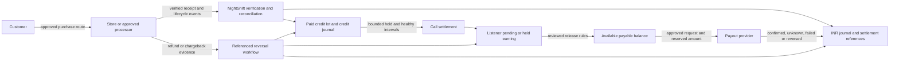

# Launch decisions requiring owner or external evidence

Prepared 20 November 2026 (Asia/Calcutta). This is a review packet for #1–3 and the downstream launch gates. It records proposals and missing evidence; it does not grant approval, register accounts, purchase services, enable production or close issues. Agilan Deenadhayalan is the decision contact. Named finance, safety and professional reviewers still require confirmation.

The existing [decision register](Decision_Register.md) remains authoritative for recorded decisions. The owner-edited scope/register in the original checkout were read and preserved. This packet carries their unresolved ownership, spending, support and cohort questions forward without overwriting them. Private test video is authorized as recorded in D22/D24; public video still depends on #57/#58. NightShift remains one application with Customer and Listener modes and separate staff tooling.

## Decisions needed first

The following three bundles contain the minimum information needed to choose the next external verification work. Answers can state “not created” or “not approved”; that is actionable and does not stop independent local engineering. Share status and non-secret identifiers only. Provider keys, certificates, service-account files, OTPs, banking documents and full phone numbers belong in the approved private configuration or restricted operational records.

| Bundle | Owner input | Concrete consequence |
|---|---|---|
| Publisher and Play account | Owner has supplied **personal account, India**. Still needed: creation date; verified/activated status; current production-access/testing status; publisher/entity decision; whether `com.nightshift.app` is the permanent identifier. | Determines the account-specific #2/#55 checklist. A Google login alone does not establish an activated publisher account. |
| Identity and media projects | Firebase Phone/India policy, Android registration, Blaze and budget are verified. Dedicated verifier identity and isolated server credential now pass the live Admin read-permission probe; the owner confirms sign-in reaching Customer on both phones, backed by two verified phone identities and completed onboardings. Manual delivery versus automatic verification, refresh/revocation and release evidence remain. Confirm the previously exposed Agora certificate was replaced privately | Determines whether #6/#9/#25 can move from fixtures to bounded provider evidence. Firebase supersedes the older MSG91/Twilio choice; do not request superseded provider setup. No credentials or OTPs belong in chat. |
| Responsible people and limits | Product decision authority; accountable finance owner and CA/legal reviewers; safety/support owner plus backup and staffed hours; any already approved provider/pilot spending limit | Makes the operational gates and scope of externally billable testing explicit. No new spending cap is inferred from a planning estimate. |

### Play Console observation — 20 November 2026

The owner supplied a developer-account home link for read-only inspection. In the connected Chrome session it redirected to the Console's `accept-terms` page. Opening **Review Terms of Service** displayed a **Play Console Terms of Service** modal, marked effective **29 April 2020**, with Accept and Cancel controls. No terms were accepted and no account settings were changed. The terms' effective date is not the account creation date.

The owner subsequently supplied **personal account, India** and reported a trader-status declaration and no website. These are owner-provided facts, not independently verified Console fields. No private legal name, street address, email or developer account identifier is copied into this document. The reported declaration does not establish its selected value, review status or legal applicability.

Read-only inspection was resumed after that reply. The connected Chrome session still redirected the supplied home link to `accept-terms`; no account detail or app list was available. Account creation date, publisher verification, NightShift app existence, actual testing requirements and production-access status therefore remain **unverified**. The live page was left for the owner. Resume from the correct accessible account/profile when available. Do not infer testing applicability or account activation from the URL or the terms' effective date.

Update, 21 November 2026: read-only inspection in the owner's requested Opera profile reached the account home and Account details without a terms gate. **Personal account** is now independently verified. The home displays **Create your first app**; no NightShift app record exists in this account yet. It also displays **Declare your trader status by February, 2027**, with the declaration marked Action required. The declaration dialog offers trader/non-trader and neither was selected. The owner has been asked which factual status applies; no declaration, public-profile change or app creation was submitted. Account creation date and app-specific testing/production access remain unverified. No legal name, street address or account identifiers from the page are copied here.

The owner then selected **Trader account**. That choice was prepared in the dialog; Google's next step requires verification of the developer phone number that will be published. The owner has been asked to enter that number and complete verification privately in Opera, leaving the final declaration unsubmitted. Google displays that the developer email, legal name/address and developer phone number will appear publicly. No number was entered, verification SMS sent or final declaration submitted by this continuation.

## #2: dated primary-source policy review

Sources below were accessed on **20 November 2026**. This is the observation date, not a claim that each policy changed on that date. Account facts, product classification and provider approvals remain unverified. Recheck the relevant primary pages and actual Console requirements before submission or any commercial integration is enabled.

Google's Payments policy lists virtual currency among in-app purchases normally requiring Play Billing, subject to its stated exceptions/programs. It also restricts steering to other payment methods outside permitted conditions and requires accurate pricing disclosure. This supports retaining Play Billing as the current engineering proposal for sold coin packs; it does not establish that the proposed business or funds flow is approved. [Google Play Payments policy](https://support.google.com/googleplay/android-developer/answer/9858738?hl=en).

Google's FAQ describes an exception for paid online services between two individuals when the session is not available for replay in a Play-distributed app. The same FAQ discusses purchased virtual currency. Whether NightShift's particular reusable coin packs and paid conversation design qualify requires a product-specific assessment; “1:1” alone is insufficient evidence. No exception is claimed here. [Understanding Google Play's Payments policy](https://support.google.com/googleplay/android-developer/answer/10281818?hl=en).

The India alternative-billing program offers an alternative alongside Play Billing for mobile/tablet users in India. The documented API route requires Console enrollment, applicable terms/payment-profile setup, PCI DSS certification and a fraud-reporting channel, API/UX integration, per-app settings, and reporting authorized transactions within 24 hours. Google still charges the applicable adjusted service fee; the stated reduction is four percentage points, not elimination of fees. Processor costs and the actual account fee remain separate inputs. No enrollment or eligibility is asserted for NightShift. [Google's India alternative-billing requirements](https://support.google.com/googleplay/android-developer/answer/13306652?hl=en).

For personal Play developer accounts created after **13 November 2023**, Google's current page requires a closed test with at least **12 testers opted in continuously for 14 days**, followed by an application for production access. A completed test period does not itself grant production access. The owner reports a personal India account, but its creation date and Console status remain unknown, so exact applicability remains pending. [Google's personal-account testing requirements](https://support.google.com/googleplay/android-developer/answer/14151465?hl=en).

### Reviewable billing choices

| Option | Proposed implementation | Evidence required before selecting/enabling commercially |
|---|---|---|
| A — Play Billing coin packs (engineering recommendation) | Versioned coin catalogue, server-verified purchases, pending/cancelled recovery, immutable paid-credit lots, refunds and reconciliation. Build using synthetic and provider sandbox cases first. | Publisher/package ownership, actual fee/program terms, approved SKUs, provider sandbox access and professional review of the funds flow. Selection does not approve a price or launch. |
| B — India alternative billing alongside Play | Preserve A and add the enrolled alternative provider, required choice UX, transaction reporting, support/refunds and two-channel reconciliation. | Actual India program enrollment, gateway underwriting, compliance responsibilities and cost comparison including both adjusted Play fees and processor charges. |
| C — Specifically reviewed direct 1:1 service route | Define exactly what is purchased, whether reusable coins are removed or changed, and how each session/refund is represented. | Documented product-specific policy analysis, any provider/Play clarification needed, and legal/finance review. This is a possible product redesign, not a shortcut around A/B. |

Until an option is recorded, the engineering assumption remains **A for sandbox design only**. Existing test-credit calls remain non-monetary. Current in-app test coins do not become sold currency, transferable value or a payout entitlement merely because a schema exists.

### Proposed funds flow for specialist review

This diagram describes proposed software records, not a legal characterization of custody, ownership, revenue or regulated activity. The finance/legal reviewers must resolve the following before real-money adapters are enabled:

| Review item | Required recorded outcome |
|---|---|
| Contracting and economic roles | Operating entity; contracting parties; principal/agent treatment; customer obligation; listener relationship; who receives and settles funds; any required provider/regulatory acceptance. |
| Tax and documentation | Applicable GST/TDS and other treatment, fee/tax bases, invoice/receipt issuer and retention. Existing percentages in the calculator are scenario inputs, not determinations. |
| Unused credits and refunds | Expiry/withdrawal/transfer rules, purchase cancellation, partial refunds and chargebacks, spent-credit treatment, already-released listener earnings and reserve/debt handling. |
| Earnings and payouts | Rate versions, rounding, eligibility, holds/appeals, minimums/maximums, approval thresholds, verified payout identity and bank-change controls. |
| Reconciliation | Named exception owner, investigation window, unknown provider outcome policy and evidence required before retrying a transfer. |

The reviewer, review date, precise product version, open conditions and approved scope must accompany a decision. No specialist sign-off is recorded by this document.

## #3: pricing, spending and pilot choices

Use the existing [economics scenarios](Economics_Scenarios.md) and calculator. Compare the specified ₹12/₹15/₹20 per-minute scenarios and 15%/30% channel-fee cases using the proposed ₹500 per 3,600 paid connected seconds. Replace modeled tax, fees, FX, media, OTP, refunds and fixed-cost assumptions with approved inputs before selecting a launch tariff. These scenarios are not current provider quotes or approved prices.

| Decision | Reviewable options and default while pending | Decision owner/evidence |
|---|---|---|
| Charging rule | A: production cumulative healthy-second tariff from the master plan. B: separately approved version of the reference's free-through-40-second/minimum-minute rule. Preserve current audio/video fixtures during comparison. No silent tariff change. | Product + finance; versioned examples for 0/1/39/40/41/59/60/61 seconds, reconnects, refunds and a six-minute earning example. |
| Customer packs and listener compensation | Select tested catalogue/paid-promo distinction and approved listener terms. ₹500/hour remains proposed; private video's 120 test coins/minute remains a fixture. | Product + finance; contribution and subsidy review, contracts and rounding/hold rules. |
| Spend authorization | Continue existing local work; authorize no new provider spend by assumption. Owner may approve a capped staging trial before any separately approved paid pilot. | Owner supplies currency, amount, period, providers, alert thresholds, hard-stop behavior and monitoring person. |
| Pilot cohort and concurrency | Start with an explicitly invited adult cohort within staffed coverage. The master plan's 10–30 listeners, 100–500 customers and 20 simultaneous calls are planning envelopes only; actual cap must fit observed capacity and funding. | Product + safety + operations; consenting roster, languages, schedules, safe capacity evidence and escalation contact. |
| Trial/top-up/payout/subsidy caps | Define per-account, per-day and campaign/organization maxima separately; no uncapped subsidy or automatic cash entitlement. | Finance; limits, effective date, reviewer and kill-switch procedure. |

## India OTP provider decision and verification packet

The owner clarified **India (+91)** as the destination, initially selected an international Twilio route, then explicitly superseded that choice with **Firebase's paid SMS service**. Native Firebase Phone Authentication is implemented for `nightshift-c3e1a`. The owner explicitly approved the displayed Play Integrity agreement; Phone is enabled and the saved SMS policy allows India only. The owner approved **1,000 SMS/day** and **₹5,000/month**. Blaze is enabled, linked to My Billing Account 3 following the selected Account 2's linked-project quota block. The saved NightShift budget is monthly ₹5,000, with actual-spend email alerts at 50%, 90% and 100%. The Authentication Console displays a 1,000 sent-SMS/day quota. Private Admin read permission is verified through the isolated impersonated credential; the server has accepted a real native phone identity and completed adult onboarding. The owner confirmed both phones reached Customer, with matching server identity/onboarding aggregates. Manual SMS versus automatic verification, actual sender/brand presentation and real-device refresh/revocation remain to be verified.

Firebase's own verification SMS requires Blaze billing, now enabled for this project. Its Android flow also requires Phone provider setup, SMS region policy and app verification. [Firebase limits](https://firebase.google.com/docs/auth/limits), [Firebase Android phone authentication](https://firebase.google.com/docs/auth/android/phone-auth). The saved alerts-only budget does not stop SMS charges; the current [Firebase spend-cap preview](https://firebase.google.com/docs/projects/billing/spend-caps) does not cover Authentication.

Pricing checked on 20 November 2026: Google's published USD rate for India is $0.07 per SMS, with the first ten SMS/day unbilled. At the owner's daily ceiling of 1,000/day for 30 days, the illustrative SMS charge is `(1,000 - 10) × 30 × $0.07 = $2,079`, before tax and any local-currency SKU differences. This is a ceiling scenario, not approved expenditure or expected traffic. Actual use must stay within the separately approved ₹5,000 monthly operating budget; 1,000/day is a maximum, not an authorized sustained sending target. [Google phone-authentication pricing](https://cloud.google.com/identity-platform/pricing).

DLT is not a universal prerequisite for every India route. Twilio documents international ILDO delivery without DLT, using operator-approved short codes; MSG91 documents an unbranded default-template option. Neither is the currently selected provider. The domestic MSG91 material below is retained only for the earlier adapter, not as a blocker to Firebase integration. [Twilio India guidelines](https://www.twilio.com/en-us/guidelines/in/sms), [MSG91 default-template FAQ](https://msg91.com/help/msg91-common-faq-s/).

For a future branded domestic MSG91 route, obtain approval/status evidence for the entity, sender/header and exact content template, then map them in the owner's MSG91 account. MSG91's guide describes these registration/mapping steps. Its OTP setup guidance permits backend SendOTP integration for use cases that need it. [MSG91 DLT process](https://msg91.com/guide/steps-for-dlt-process-registration), [MSG91 OTP configuration](https://msg91.com/help/sendotp/step-by-step-process-to-configure-otp).

MSG91 states that PE–TM chain binding applies to DLT-based Indian SMS, including OTP, and that the entity must complete its approval step after MSG91 accepts the chain. Capture the final approved state, not merely a submitted request. [MSG91 PE–TM chain binding](https://msg91.com/help/dlt-registration-in-india/pe-tm-chain-binding-on-dlt).

MSG91 also documents an unbranded default-widget path without customer DLT configuration. It does not demonstrate branded delivery or establish international routing. The owner's later Firebase selection governs the next implementation; branded domestic MSG91 setup is not its prerequisite. [MSG91 common FAQ, default OTP template](https://msg91.com/help/msg91-common-faq-s/).

Before a bounded Firebase staging test, record the project/app/fingerprint binding, Phone and India-region state, Blaze account and budget, consent notice version, recipient consent and tester. Verify native SDK proof and Admin ID-token/revocation validation, canonical phone-to-account mapping, resend/expiry/reuse behavior, app-session revocation and secret/log redaction. Record real-SIM delivery and sender presentation, masked carrier/device context, latency and cost per successful sign-in. Firebase app admissions are not proof that an SMS was sent and cannot cap direct SDK billing. Keep raw OTPs, full phone numbers and provider credentials out of evidence. API fixtures cannot establish delivery or provider approval.

## Remaining owner and external gates

| Gate | Concrete deliverable required | Related issues / decisions |
|---|---|---|
| Adult assurance and listener approval | Chosen review criteria, minimal private evidence, authorized reviewers, appeals, retention and clear distinction between self-declared age and verified evidence. | #11, #13–16, #45, #49; D18/D19 |
| Staff access and coverage | Owner-selected SMS OTP-only staff authentication with separate principals/RBAC (D26); authenticated Redmi binding and actual embedded-session evidence; named finance, safety, support and incident owners/backups, staffed hours and escalation tabletop. The owner is already appointed initial reviewer/access administrator. OTP-only is not MFA. | #10, #14, #42–47, #53, #56; D04–06/D10–11/D26 |
| Privacy, content and public copy | Reviewed notices/terms/refunds/community/child-safety/listener copy; processor inventory; retention/deletion decisions; accurate service and earnings claims. | #16, #45, #48–49, #55; D15/D19 |
| Media enforcement | Owner-controlled provider permissions/quota and proof that revoked or exhausted sessions cannot continue media with a noncooperating client. | #6, #25, #27–28, #37; D16 |
| Physical Android verification | Named consenting testers and device/network access for denied permissions, network changes, background/lock screen, interruptions, audio routes, Tamil, TalkBack and capture limits. Evidence records exact build hash. | #8, #12, #26, #28–30, #49, #51 |
| Hosting and recovery | Provider ownership, region/data decisions, reviewed costed infrastructure plan, allowed staging deployment, approved RPO/RTO and restore/canary evidence. | #53–55; D09/D21 |
| Release and money trial | Explicit capped go/no-go, actual store/provider status, supported hours, rollback owner; approved small purchase/call/refund/payout reconciliation followed by first-48-hour review. | #55–56; D21 |
| Expansion | Per-feature scope, economics, safety/privacy and provider/store evidence; private video does not open public video, chat, offers, iOS or AI. | #57–64; D22/D24 |

## Recording a decision

For each resolved item, append a decision with: ID; chosen option and scope; accountable approver; date; linked evidence; conditions/limits; expiry or next review; and dependent issues released. Use “pending”, “proposed”, “approved for staging” and “approved for production” precisely. A budget approval does not imply provider eligibility, and a passing engineering test does not imply an operational or policy approval.

No owner response, professional review, provider enrollment, spending authorization, store acceptance or public-launch decision has been invented in this packet.
