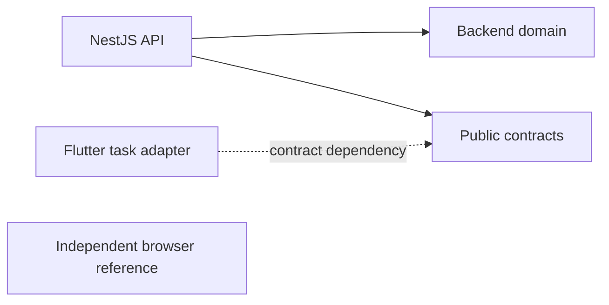

# Monorepo development

NightShift uses npm 11.6.2 workspaces for Node dependency installation and Turborepo 2.11.13 for task ordering and caching. Flutter keeps its own `pubspec.yaml`, `pubspec.lock` and native Android toolchain. This serves one Flutter application with Customer and Listener modes and one modular NestJS backend; it does not create additional mobile applications or backend services.

The decision and alternatives are recorded in [ADR-0002](adr/0002-monorepo-task-graph.md). The runnable workspace list is explicit in the root `package.json`; a directory is not registered until it contains real work.

Actual local checks and artifact details are recorded in [monorepo verification](Monorepo_Verification.md).

## Package ownership

| Workspace/path | Responsibility | Allowed internal dependencies |
|---|---|---|
| `apps/api` | NestJS HTTP/socket adapters, authorization, PostgreSQL transactions, provider adapters and recovery | `backend-domain`, `contracts` |
| `apps/mobile` | One Flutter Android app; its npm manifest is a task adapter | Public Dart SDK from `contracts`, plus task metadata |
| `packages/backend-domain` | Pure server-side billing rules, exported through the package entry point | None at runtime |
| `packages/contracts` | Public OpenAPI/event schemas and generated Dart SDK | None among internal workspaces |
| `audio` | Runnable independent browser reference with test credits | None |
| `apps/admin`, `apps/web`, `apps/worker` | Reserved staff, public-site and worker boundaries | Not registered yet |
| `packages/config` | Reserved configuration boundary | Not registered yet |

Arrows describe repository dependencies. Flutter makes network requests to NestJS; it does not load TypeScript packages at runtime. The generated Dart SDK lives in `packages/contracts/dart` and is referenced through Flutter's native path dependency. The handwritten mobile facade retains runtime configuration, safe errors and request deadlines while generated operations own endpoint paths, bodies and response decoding.

Applications must not import another application's source. Shared code goes into a package with an explicit public entry point or exported subpath and a declared dependency in the consuming package. For example, `@nightshift/contracts/openapi.json` is public; private `/src` imports are not. Do not use relative paths or TypeScript path aliases to bypass this boundary. Dependencies belong in the package that imports them; root dependencies are repository tooling. The monorepo guard checks the registered graph and source boundaries; it complements code review rather than proving all architectural properties.

`backend-domain` stays independent of NestJS, PostgreSQL, Redis and provider SDKs. The API supplies persistence and authorization around those pure rules. Do not move server financial computation into Flutter or public browser code. Contracts contain public shapes and examples, never credentials, privileged configuration or customer data. Staff tooling remains a separate application and is never a third mobile mode. Add a worker package when it has an actual entry point and responsibility; it can consume the same backend-domain package.

## Commands and task graph

Run `npm ci` once at the repository root using the pinned Node/npm versions. Keep the root `package-lock.json`; do not create nested npm lockfiles. Flutter resolves Dart dependencies through its committed `pubspec.lock`.

| Root command | Scope |
|---|---|
| `npm run check:repo` | Secret/boundary guards, contract drift checks and tooling regression tests |
| `npm run check:boundaries` | Workspace policy and backend-domain import boundaries |
| `npm run generate:client` | Regenerate the checked-in Dart SDK with the pinned official generator; Java 17+ required |
| `npm run check:client` | Regenerate in a temporary directory and reject SDK drift; Java 17+ required |
| `npm run typecheck` | TypeScript workspaces |
| `npm run build` | TypeScript builds in dependency order |
| `npm test` | TypeScript unit tests and browser-reference tests |
| `npm run test:integration` | API tests against dedicated PostgreSQL/Redis services |
| `npm run test:audio` | Browser-reference Node tests |
| `npm run test:economics` | Python economics model tests |
| `npm run mobile:setup` | Flutter dependency resolution |
| `npm run check:mobile` | Flutter static analysis and tests |
| `npm run build:android` | ARM64 Android debug APK |
| `npm run db:migrate`, `npm run db:seed` | Explicit local database operations |
| `npm run start:api` | Backend process |
| `npm run smoke:client` | Real HTTP test-credit call/history journey through the generated Dart SDK; local API required |

Build dependencies before their consumers. A backend-domain change must invalidate the API build; a contract change must reach API and mobile checks through their declared graph edges. Use the installed runner's dry-run output to inspect the task graph, for example `npm exec turbo -- run build --dry=json`. Avoid calling a root Turbo task from a workspace script, which would recurse into the same graph.

The default TypeScript build and typecheck select the API and its package dependencies, without requiring Flutter or an Android SDK. Run mobile commands on Windows with the pinned Flutter toolchain, or use the direct Flutter commands in the [local setup guide](Local_Development.md). Mobile analysis/tests/builds depend on uncached `flutter pub get` setup. Keep explicit API startup and database tasks separate from verification so a code check does not modify a developer's database.

## Cache policy

| Task category | Turborepo cache policy |
|---|---|
| Pure TypeScript build | Cached, with every emitted `dist/**` file declared as an output |
| Deterministic static/contract checks | Cached only with complete source, config and contract inputs |
| Unit, integration and browser-reference tests | Uncached; each invocation executes tests |
| Flutter dependency resolution, analysis, tests and APK builds | Uncached |
| Dart client generation and regeneration comparison | Uncached; generator JAR has a pinned checksum |
| Database migrations/seeding, service startup and smoke checks | Uncached; long-running services are persistent tasks |

Keep shared TypeScript settings, tool pins and contract inputs in the task hash. Do not narrow inputs without proving that generated files and dependencies still invalidate downstream tasks. Changing the task configuration itself is a build change. A successful cache replay is not evidence that an integration test ran against the current database.

Flutter builds depend on the host OS, SDK/JDK/Android tooling and local debug signing state. They remain uncached in Turbo; Flutter, Pub and Gradle retain their native caches. Do not share `.dart_tool`, Gradle state, Android `local.properties` or installed `node_modules` between Windows and Linux processes. Turbo does not inherently make platform-specific outputs portable. See its [platform guidance](https://turborepo.dev/docs/guides/handling-platforms).

Runtime/database tasks must explicitly receive the environment variables they need under Turbo's strict environment mode. Pass-through variables are suitable for uncached runtime tasks; any variable affecting cached build output belongs in the task's hashed `env` inputs. Node's existing environment-file arguments load the ignored root `.env`; Turbo does not load it automatically. Do not log environment values or add secret-bearing files to task outputs. See [Turbo environment handling](https://turborepo.dev/docs/crafting-your-repository/using-environment-variables).

Local `.turbo` outputs remain ignored; remote caching is explicitly disabled in `turbo.json`. Review outputs, logs and access controls before changing that policy; never put provider credentials or local databases into a cache artifact.

## Windows, WSL 2 and Docker

Use Windows for Flutter and Android, and WSL 2 for the backend and local Compose stack as described in [Local_Development.md](Local_Development.md). Use one Docker context consistently. Separate Windows and Linux dependency directories/checkouts are preferable; never run their installs concurrently against the same `node_modules`.

The API container must include every manifest needed by `npm ci`, the API's compiled output and the compiled runtime packages it imports. npm workspace links point to real package directories; copying only the API's `dist` breaks shared-package resolution. Keep SQL migrations available at the path used by the compiled migration runner. Container smoke verification must exercise migration, seed, health and an actual API request after any layout change. Exclude Flutter build outputs, provider files, `.env` and local databases from the image context.

## Adding a workspace

1. Establish a runnable application or genuinely shared package with one responsibility. Keep planned directories unregistered until then.
2. Add its private manifest, explicit dependencies, package exports and task scripts. Update the root workspace allowlist and monorepo policy together.
3. Declare build outputs, upstream dependencies, environment inputs and cache behavior. Leave externally stateful tasks uncached.
4. Update Docker inputs if the API runtime dependency closure changes. Keep one npm lockfile and the Dart lockfile.
5. Run repository checks, affected tests and builds, and inspect the task graph. Document any new provider or owner decision separately.

This structure improves engineering reproducibility. It does not close provider, release or two-phone acceptance gates; those remain in [Issue_Status.md](Issue_Status.md) and [Two_Phone_Test.md](Two_Phone_Test.md).
